# Supported Assets

Everything Nerkh can track today — **100 assets** in all: world currencies, regional and remittance markets, gold, precious metals, Iranian coins, and crypto. Each one comes with its own icon, so you spot it fast in a long list.

Jump to a group:

- [Currencies](#currencies) — 44
- [Gold, Metals & Coins](#gold-metals--coins) — 13
- [Crypto](#crypto) — 43

---

## Currencies

Everyday world money, national currencies, and free regional/remittance markets (with concurrent `_` and `-` support).

|   | Symbol | English | فارسی |
| :-: | ------ | ------- | ----- |
|  | `USD` | US Dollar | دلار آمریکا |
|  | `EUR` | Euro | یورو |
|  | `AED` | UAE Dirham | درهم امارات |
|  | `GBP` | British Pound | پوند انگلیس |
|  | `JPY` | Japanese Yen | ین ژاپن |
|  | `KWD` | Kuwaiti Dinar | دینار کویت |
|  | `AUD` | Australian Dollar | دلار استرالیا |
|  | `CAD` | Canadian Dollar | دلار کانادا |
|  | `CNY` | Chinese Yuan | یوان چین |
|  | `TRY` | Turkish Lira | لیر ترکیه |
|  | `SAR` | Saudi Riyal | ریال عربستان |
|  | `CHF` | Swiss Franc | فرانک سوئیس |
|  | `INR` | Indian Rupee | روپیه هند |
|  | `PKR` | Pakistani Rupee | روپیه پاکستان |
|  | `IQD` | Iraqi Dinar | دینار عراق |
|  | `SYP` | Syrian Pound | لیر سوریه |
|  | `SEK` | Swedish Krona | کرون سوئد |
|  | `QAR` | Qatari Riyal | ریال قطر |
|  | `OMR` | Omani Rial | ریال عمان |
|  | `BHD` | Bahraini Dinar | دینار بحرین |
|  | `AFN` | Afghan Afghani | افغانی افغانستان |
|  | `MYR` | Malaysian Ringgit | رینگیت مالزی |
|  | `THB` | Thai Baht | بات تایلند |
|  | `RUB` | Russian Ruble | روبل روسیه |
|  | `AZN` | Azerbaijani Manat | منات آذربایجان |
|  | `AMD` | Armenian Dram | درام ارمنستان |
|  | `GEL` | Georgian Lari | لاری گرجستان |
|  | `KRW` | 100 South Korean Won | ۱۰۰ وون کره جنوبی |
|  | `NOK` | Norwegian Krone | کرون نروژ |
| 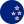 | `NZD` | New Zealand Dollar | دلار نیوزیلند |
|  | `SGD` | Singapore Dollar | دلار سنگاپور |
|  | `HKD` | Hong Kong Dollar | دلار هنگ‌کنگ |
|  | `DKK` | Danish Krone | کرون دانمارک |
| 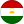 | `TJS` | Tajikistani Somoni | سامانی تاجیکستان |
| 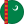 | `TMT` | Turkmenistani Manat | منات ترکمنستان |
|  | `KGS` | Kyrgyzstani Som | سوم قرقیزستان |
| 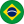 | `BRL` | Brazilian Real | رئال برزیل |
| 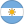 | `ARS` | Argentine Peso | پزو آرژانتین |
|  | `USD_HAV` | US Dollar (Remittance) | دلار حواله |
|  | `USD_IST` | US Dollar (Istanbul) | دلار استانبول |
|  | `USD_SULAYMANIYAH` | US Dollar (Sulaymaniyah) | دلار سلیمانیه |
|  | `USD_HERAT` | US Dollar (Herat) | دلار هرات |
|  | `EUR_HAV` | Euro (Remittance) | یورو حواله |
|  | `EUR_IST` | Euro (Istanbul) | یورو استانبول |

**44 currencies**

---

## Gold, Metals & Coins

Gold by the gram, global ounces (Gold, Silver, Platinum, Palladium, Rhodium), and Iranian coins.

|   | Symbol | English | فارسی |
| :-: | ------ | ------- | ----- |
|  | `IR_GOLD_18K` | Gold 18K / gram | طلای ۱۸ عیار |
|  | `IR_GOLD_24K` | Gold 24K / gram | طلای ۲۴ عیار |
|  | `IR_GOLD_MELTED` | Melted gold | طلای آبشده |
|  | `XAUUSD` | Gold ounce (XAU/USD) | انس جهانی طلا |
| 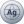 | `XAGUSD` | Silver ounce (XAG/USD) | انس جهانی نقره |
|  | `XPTUSD` | Platinum ounce (XPT/USD) | انس جهانی پلاتین |
| 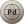 | `XPDUSD` | Palladium ounce (XPD/USD) | انس جهانی پالادیوم |
|  | `XRHUSD` | Rhodium ounce (XRH/USD) | انس جهانی رودیم |
|  | `IR_COIN_1G` | 1g coin | سکهٔ یک گرمی |
|  | `IR_COIN_QUARTER` | Quarter coin | ربع سکه |
|  | `IR_COIN_HALF` | Half coin | نیم سکه |
|  | `IR_COIN_EMAMI` | Emami coin | سکهٔ امامی |
|  | `IR_COIN_BAHAR` | Bahar Azadi coin | سکهٔ بهار آزادی |

**13 gold, metal & coin assets**

---

## Crypto

The major cryptocurrencies, DeFi, layer-1s, meme tokens, and Tether priced straight in Toman.

|   | Symbol | English | فارسی |
| :-: | ------ | ------- | ----- |
|  | `USDT_IRT` | Tether / Toman | تتر / تومان |
|  | `BTC` | Bitcoin | بیت‌کوین |
|  | `ETH` | Ethereum | اتریوم |
|  | `USDT` | Tether | تتر |
|  | `XRP` | XRP | ریپل |
|  | `BNB` | BNB | بی‌ان‌بی |
|  | `SOL` | Solana | سولانا |
|  | `USDC` | USD Coin | یو‌اس‌دی‌کوین |
|  | `TRX` | TRON | ترون |
|  | `DOGE` | Dogecoin | دوج‌کوین |
|  | `ADA` | Cardano | کاردانو |
|  | `LINK` | Chainlink | چین‌لینک |
|  | `XLM` | Stellar | استلار |
|  | `AVAX` | Avalanche | آوالانچ |
|  | `SHIB` | Shiba Inu | شیبا اینو |
|  | `LTC` | Litecoin | لایت‌کوین |
|  | `DOT` | Polkadot | پولکادات |
|  | `UNI` | Uniswap | یونی‌سواپ |
|  | `ATOM` | Cosmos | کازموس |
|  | `FIL` | Filecoin | فایل‌کوین |
|  | `TON` | Toncoin | تونکوین |
| 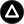 | `NOT` | Notcoin | ناتکوین |
|  | `PEPE` | Pepe | پپه |
| 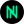 | `NEAR` | NEAR Protocol | نیر پروتکل |
|  | `AAVE` | Aave | آوه |
| 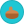 | `CAKE` | PancakeSwap | پنکیکسواپ |
|  | `EOS` | EOS | ایاس |
|  | `SAND` | The Sandbox | سندباکس |
|  | `MANA` | Decentraland | دیسنترالند |
|  | `GRT` | The Graph | گراف |
|  | `XTZ` | Tezos | تزوس |
|  | `FLOW` | Flow | فلو |
|  | `AXS` | Axie Infinity | اکسی اینفینیتی |
|  | `CHZ` | Chiliz | چیلیز |
|  | `ENJ` | Enjin Coin | انجین کوین |
| 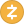 | `ZEC` | Zcash | زدکش |
|  | `GALA` | Gala | گالا |
|  | `LRC` | Loopring | لوپرینگ |
|  | `BAT` | Basic Attention Token | بیسیک اتنشن توکن |
|  | `ONE` | Harmony | هارمونی |
| 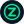 | `ZEN` | Horizen | هورایزن |
|  | `CVC` | Civic | سیویک |
| 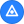 | `STORJ` | Storj | استورج |

**43 cryptocurrencies**

---

## At a glance

| Group | Count |
| ----- | ----: |
| Currencies | 44 |
| Gold, Metals & Coins | 13 |
| Crypto | 43 |
| **Total** | **100** |

> This list grows over time as new assets land in Nerkh.

---

[← Back to Nerkh](README.md)
